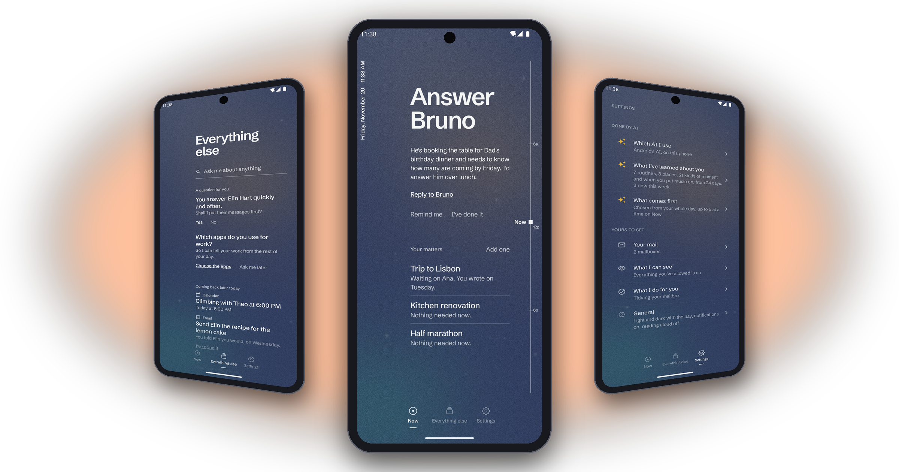

  
  <h1>Triage</h1>
  
<b>Knows what moment of your day you're in, and what needs you in it.</b> It goes by your whole day: how you slept, where you are, what's next, what you're carrying. Then it shows you the one thing to do.

  
<b>Private.</b> All of it happens on your phone, and nothing it reads ever leaves it. No server. No account. No sign-in. <b>Works with <a href="https://iamvanity.com">Vanity</a>.</b> If you use it, Triage can tell Vanity what needs you. Only what to do and when. Never your messages.

  

    
    
    
    
    
  

  

    
  

  

<table>
  <tr>
    <td width="33%" valign="top"><b>Everything else</b> What can wait, waits here.</td>
    <td width="34%" valign="top"><b>Now</b> The one thing that needs you, and what to do about it.</td>
    <td width="33%" valign="top"><b>Your day</b> How you slept, where you are, what's next.</td>
  </tr>
</table>

Be honest. It's 1:38 on a Thursday. Dad's birthday is Saturday, the flights to Lisbon aren't picked, and the kitchen still has no tiles. Which one needs you right now?

Triage knows.

It goes by your day. If you let it, it notices how you slept, where you are, whether you're on the move, what's on your calendar and what people have asked of you. Then it shows you the one thing that fits this moment, and holds the rest until its moment comes.

It isn't an inbox. Mail and chats are one of the things it notices, the same way sleep is. What it follows is what you're carrying, like a residence permit or a kitchen renovation, across whoever wrote and whichever app they wrote in. When something needs an answer, it drafts one. You read it, and you press Send.

And all of it happens on your phone. There is no Triage server. No account. No sign-in. Nothing you receive ever reaches me.

## Get it

| | Download | Runs on | Size |
| --- | --- | --- | --- |
| **Android** | [Triage-0.3.apk](https://github.com/MichaelLisboa/triage-releases/releases/download/v0.3/Triage-0.3.apk) | Android 13 or later | 52 MB |

This is version 0.3. It's an alpha. Things will break.

## What it needs

- **A phone that can run AI by itself.** Some have it built in: recent Pixels, and Samsung's Galaxy S25, Z Flip7 and Z Fold7 or newer. On other phones with plenty of memory, around 12 GB, Triage downloads one, once: 2.6 GB. On a phone with neither, it says so and stops there.
- **English, for now.** It translates messages that arrive in other languages. Triage itself only speaks English.
- **Your mail, if you want it in.** Triage works without it. Gmail, iCloud, Yahoo, AOL, Fastmail and most others work. Gmail and iCloud make you create an app password first, and Triage walks you through it. Outlook, Hotmail and Microsoft 365 sign in on Microsoft's own page. A work or school mailbox may need your workplace to allow it.

## Your phone will complain

Triage doesn't come from the Play Store, so your phone will ask if you're sure. You're sure.

- Open the file, and let your browser or file manager install apps when it asks.
- If your phone offers to scan the app first, let it.
- Later, when you let Triage read your chats, the switch may be greyed out. Open your phone's **Settings → Apps → Triage**, tap the three dots at the top, and choose **Allow restricted settings**. Then try again. Triage tells you this too, when it happens.

> [!IMPORTANT]
> **On a Samsung**, the phone may refuse outright. Open **Settings → Security and privacy → Auto Blocker**, switch it off, and open the file again. You can switch it back on afterwards. It has to be off again whenever Triage updates.

## It asks for a lot

Sleep and steps. Where you are. Your calendar and contacts. Which apps you use. Mail, chats and text messages.

Each one is a question, and you can say no to any of them. Triage works with whatever you allow.

What it reads stays on your phone. The whole list of what it reads, what it keeps and where it connects is in [PRIVACY.md](PRIVACY.md). It's the same text the app shows you before you start, word for word.

## It updates itself

When there's a newer version, Triage says so when you open it. Tap **Update**.

The first time, your phone asks whether Triage is allowed to install it. Say yes and come back. After that it's one tap, and everything you have stays where it was.

## Something broke?

Good. That's what an alpha is for.

[Open an issue](https://github.com/MichaelLisboa/triage-releases/issues) and tell me what happened. Questions, revelations and insults are all welcome.

Thanks for trying it.

---

  <a href="PRIVACY.md">Privacy</a> · <a href="https://github.com/MichaelLisboa/triage-releases/issues">Report a problem</a> · <a href="https://github.com/MichaelLisboa/triage-releases/releases">All versions</a>

